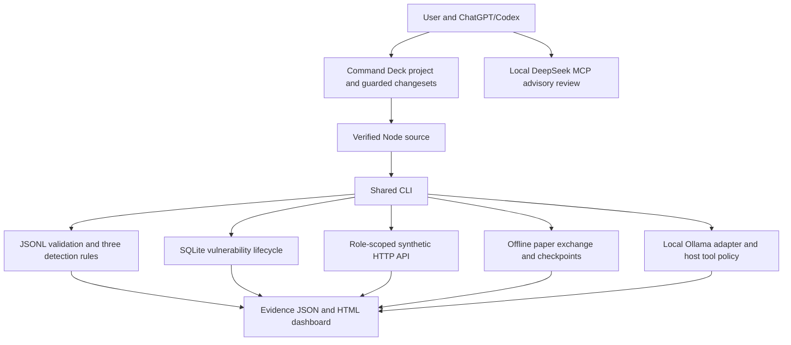

# Architecture and boundaries

The CLI shares only utilities and reporting between projects. Security events do not create remediation actions automatically. A future SOC-to-remediation adapter must preserve source identity and human disposition; an alert is not automatically a confirmed vulnerability.

The model sees synthetic fixtures and task descriptions. It never receives a filesystem executor, the Command Deck token, user databases or an arbitrary network URL. The Deck adapter attaches its local credential inside host code to a fixed loopback read endpoint and returns only the project name/hash. JSON schema constraints guide generation; host allowlist validation remains mandatory.

The local remediation database is an operator tool. A separate role-scoped Workers/D1 API now provides multi-identity service access to findings and retests. Unique scan/finding identities, foreign keys, validation-before-transaction and append-only observations preserve provenance. Scan import order cannot replace a newer fix with older evidence.

The church API derives identities from signed expiring sessions and derives roles from stored users. Data access selects permitted rows in host queries and projects private fields out of volunteer responses. The loopback deployment is its security boundary; production hosting would require HTTPS, managed identities, operational logging, secret rotation and an independent review. Its generated bootstrap files are private operational artifacts and excluded from CI upload lists.

Paper exchange state changes are computed against a cloned state and committed only after validation. Pending buy/sell orders reserve exposure and resources. Event IDs provide idempotency; a mutated replay of an existing ID is a conflict. Checkpoints are checksummed for accidental corruption and rebuilt from their ledger. A local checksum is not a signature and does not defend against an attacker able to rewrite both data and digest.

Release packages contain copied executable source and a manifest. Tests verify that changed source is rejected and actual subprocesses return build identities v1, v2, v1. CI performs deterministic checks without a model dependency. The real Docker image is exercised and scanned; separate deployed primary/recovery D1 databases verify export/restore. GitHub CI checks Windows/Linux behavior, container startup/scanning and deployed cloud health.

## Implementation references

- [Node 22 SQLite API](https://nodejs.org/download/release/latest-jod/docs/api/sqlite.html): DatabaseSync and the backup function used by the local stores.
- [SQLite backup behavior](https://sqlite.org/backup.html): database-aware backup instead of copying a live database blindly.
- [Ollama structured output API](https://github.com/ollama/ollama/blob/main/docs/api.md): schema-constrained generation, followed by independent host validation.

These references informed API use; the local regression and integration reports establish what was actually verified in this environment.
